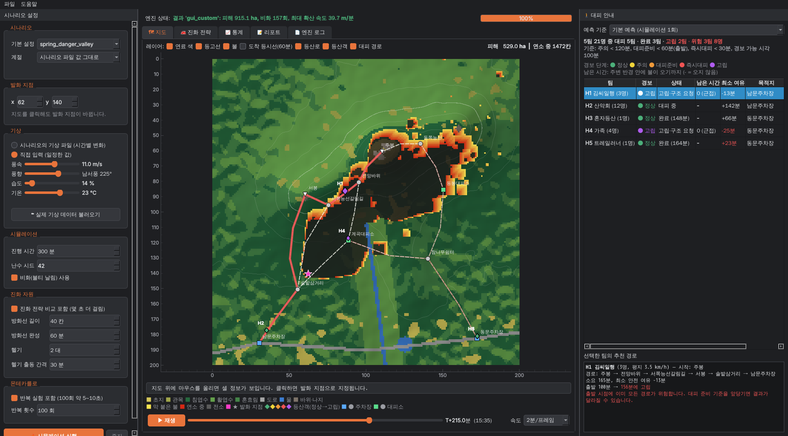
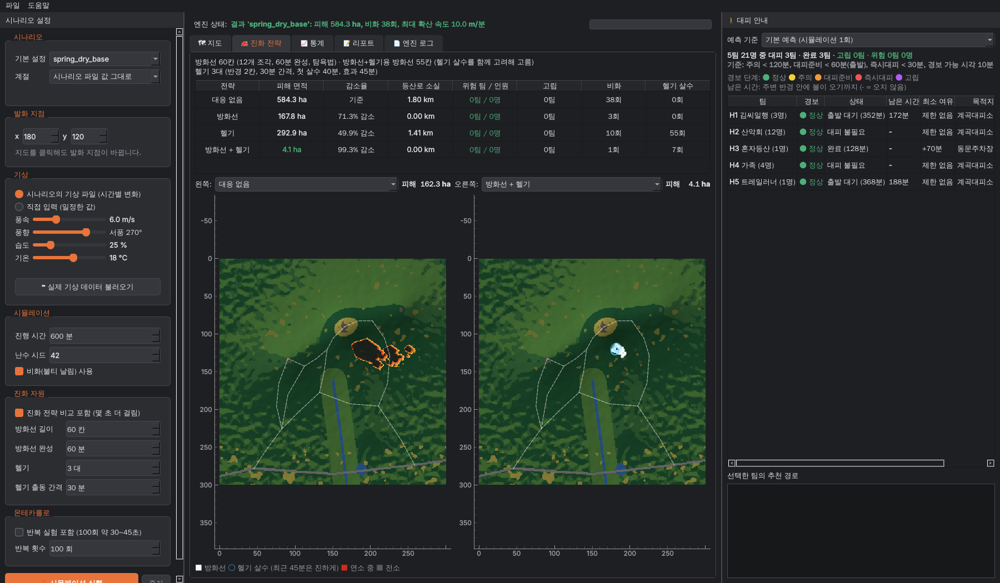
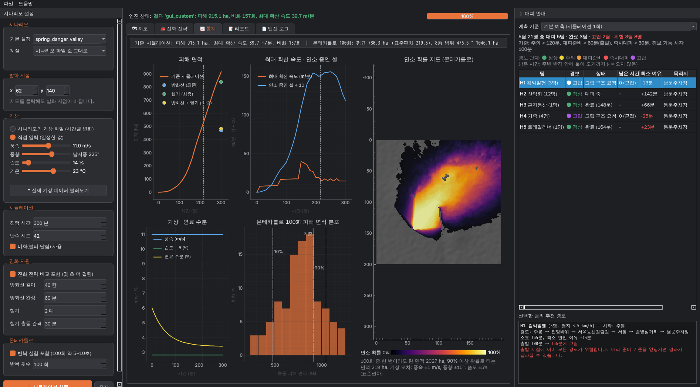

# 산불 확산 예측 및 등산객 대피 안내 시스템

기상 데이터를 받아 산불이 어떻게 번질지 예측하고, 산에 있는 등산객에게 가장 안전한 대피 경로를 안내하며,
방화선·진화 헬기를 어디에 배치하면 피해가 가장 줄어드는지 계산하는 시스템입니다. (C언어기초 팀 프로젝트)

- **C 계산 엔진** (`c_core/`, `wildfire.exe`, 약 9,000줄): 지도 읽기, 확산 시뮬레이션, 대피 경로, 진화 전략, 몬테카를로 등 모든 계산
- **Python GUI** (`gui/`·`tools/`, 약 4,400줄): 화면, 애니메이션, 기상청 API, 가상 지형 생성



> 개발 완료 (7단계). 설계는 [`docs/PROJECT_SPECIFICATION.md`](docs/PROJECT_SPECIFICATION.md), 계산 모델은 [`docs/model.md`](docs/model.md),
> 발표 자료는 [`docs/presentation_notes.md`](docs/presentation_notes.md), 단계별 기록은 [`docs/CHANGELOG.md`](docs/CHANGELOG.md)

---

## 빠른 시작

1. **C 엔진 빌드** — "Developer Command Prompt for VS 2022"에서:

   ```bat
   cd (저장소 폴더)\c_core
   build.bat
   ```

2. **Python 패키지 설치** (Python 3.12, 저장소 폴더에서):

   ```bash
   python -m pip install -r gui/requirements.txt
   ```

3. **GUI 실행**:

   ```bash
   python gui/main.py
   ```

   왼쪽에서 시나리오를 고르고 **🔥 시뮬레이션 실행**을 누르면 됩니다.

4. (선택) **자동 테스트** — 엔진과 Python 도우미 26개 항목:

   ```bash
   python tools/run_tests.py
   ```

---

## 기능

| 기능 | 내용 |
|---|---|
| 산불 확산 예측 | 연료(숲 종류)·경사·바람·습도를 반영한 Rothermel 단순화 모델, 300×300칸(30 m, 9 km × 9 km) 격자에서 1분 단위로 10시간 진행, 비화(불티) |
| 연료 수분 | 기온·습도 → 평형 수분(Simard 1968) → 1시간 지연, 남향 사면 보정 |
| 등산객 대피 | 등산로 그래프 위에서 "불 도착 시각 − 내가 지나는 시각"(안전 여유)이 가장 큰 경로(다익스트라 변형), 경사에 따른 보행 속도(Tobler), 5단계 경보(정상·주의·대피준비·즉시대피·고립) |
| 진화 전략 | 점화 트리 + 탐욕법으로 방화선 위치 탐색, 헬기 살수, 대응 없음 / 방화선 / 헬기 / 둘 다 4가지 비교(피해 면적·위험 등산객) |
| 몬테카를로 | N회 반복(비화·기상 오차) → 연소 확률 지도, 피해 면적 분포, "가장 이른 10%" 기준 보수적 대피 안내 |
| 실제 기상 | 기상청 단기예보 API → 엔진 기상 파일 (인터넷이 없으면 샘플 파일) |
| GUI | 지도 애니메이션, 대피 안내, 전략 나란히 비교, 통계 그래프, HTML 리포트 저장 |

| | |
|---|---|
|  |  |

---

## 1. 폴더 구조

```
(저장소 폴더)/
├── c_core/            C 계산 엔진
│   ├── include/       헤더 (구조체 정의: wf_types.h)
│   ├── src/           소스 (기능별 24개 파일)
│   ├── build.bat      Windows 빌드 스크립트 (Visual Studio 2022)
│   └── build.sh       macOS/Linux 확인용 빌드 스크립트
├── gui/               Python GUI
│   ├── main.py        시작점
│   ├── views/         화면 (지도, 대피, 진화 전략, 통계, 리포트, 기상 대화상자 ...)
│   └── services/      엔진 실행, 결과 읽기, 시나리오 쓰기, 기상 API, 지형·등산로 생성기
├── data/
│   ├── maps/          지형·연료 격자 (.asc)
│   ├── trails/        등산로 그래프, 등산객 목록
│   ├── weather/       기상 데이터 (CSV, 샘플 포함)
│   └── scenarios/     시나리오 설정 (.ini), 연료 모델 표, 계절 프리셋, tests/ (오류 확인용)
├── config/            API 키 양식 (api_keys.example.ini)
├── output/            엔진이 저장하는 결과 (git 제외)
├── tools/             run_tests.py (자동 테스트), count_lines.py (줄 수 집계)
└── docs/              설계·모델·발표 자료, 변경 기록, 줄 수, 화면 그림, 프롬프트 기록
```

## 2. 준비물

| 항목 | 버전 | 용도 |
|---|---|---|
| Visual Studio 2022 | "C++를 사용한 데스크톱 개발" 워크로드 | C 엔진 빌드 (MSVC) |
| Python | 3.12 | GUI, 데이터 생성 |
| Python 패키지 | `python -m pip install -r gui/requirements.txt` | numpy, PySide6, pyqtgraph, requests |

## 3. C 엔진 빌드

### 방법 A: build.bat (추천)

1. 시작 메뉴에서 **"Developer Command Prompt for VS 2022"** 를 엽니다. (일반 cmd 에서는 `cl` 을 찾지 못합니다)
2. 저장소의 `c_core` 폴더로 이동해 빌드합니다.

```bat
cd (저장소 폴더)\c_core
build.bat
```

성공하면 `c_core\bin\wildfire.exe` 가 만들어집니다.
사용하는 컴파일 옵션: `/std:c11 /W4 /utf-8 /O2 /D_CRT_SECURE_NO_WARNINGS`

### 방법 B: Visual Studio 빈 프로젝트

1. Visual Studio 2022 → **새 프로젝트 만들기** → **빈 프로젝트**(C++) → 이름 `wildfire`, 위치는 아무 곳이나.
2. 솔루션 탐색기에서 **소스 파일** 우클릭 → **추가 → 기존 항목** → `c_core\src\*.c` 를 모두 선택.
3. **헤더 파일** 우클릭 → **추가 → 기존 항목** → `c_core\include\*.h` 를 모두 선택.
4. 프로젝트 우클릭 → **속성** (위쪽 "구성"을 **모든 구성**, "플랫폼"을 **x64**로 선택한 뒤 아래를 설정)

   | 위치 | 항목 | 값 |
   |---|---|---|
   | C/C++ → 일반 | 추가 포함 디렉터리 | `(저장소 폴더)\c_core\include` (실제 경로) |
   | C/C++ → 일반 | 경고 수준 | 수준 4 (`/W4`) |
   | C/C++ → 일반 | SDL 검사 | 아니요 (`/sdl-`) |
   | C/C++ → 언어 | C 언어 표준 | ISO C11 표준 (`/std:c11`) |
   | C/C++ → 전처리기 | 전처리기 정의 | 맨 앞에 `_CRT_SECURE_NO_WARNINGS;` 추가 |
   | C/C++ → 명령줄 | 추가 옵션 | `/utf-8` |
   | 링커 → 시스템 | 하위 시스템 | 콘솔 (`/SUBSYSTEM:CONSOLE`) |
   | 디버깅 | 명령 인수 | `..\data\scenarios\spring_dry_base.ini --mode printmap` |
   | 디버깅 | 작업 디렉터리 | `(저장소 폴더)\c_core` (실제 경로) |

5. **Ctrl+Shift+B** 로 빌드, **Ctrl+F5** 로 실행.

> `/utf-8` 이 없으면 한글 주석·메시지 때문에 경고(C4819)나 글자 깨짐이 생깁니다.
> GUI는 먼저 `c_core\bin\wildfire.exe` 를 찾고, 없으면 `c_core` 폴더 안의 다른 `wildfire.exe`(예: 방법 B의 `x64\Debug`)를 찾아 씁니다.
> Visual Studio 프로젝트를 `c_core` 바깥에 만들었다면 만들어진 exe 를 `c_core\bin\` 으로 복사하세요.

### 문제 해결: "엔진 실행 파일이 없습니다"가 뜰 때

`build.bat` 은 **build.bat 파일이 있는 폴더의 `bin\`** 에 exe 를 만듭니다. 빌드가 성공했는데도 이 오류가 나면 대개 **다른 복사본에서 빌드한 경우**입니다.

- GitHub에서 ZIP으로 받으면 `dieudieu-main\dieudieu-main\` 처럼 폴더가 두 겹이 되기 쉽습니다. 압축을 여러 번 풀었거나 ZIP 안에서 바로 실행하지 않았는지 확인하세요.
- GUI 오류 메시지의 "이 GUI 가 쓰는 c_core 폴더"와, 빌드 끝에 나오는 `[빌드 성공] (경로)\bin\wildfire.exe` 의 경로가 같은지 비교하세요.
- 경로가 같은데도 exe 가 없으면 **백신이 오탐으로 격리**한 경우입니다. 직접 컴파일한 서명 없는 새 exe 는 백신이 의심하는 경우가 많습니다.
  - **Windows Defender**: Windows 보안 → 바이러스 및 위협 방지 → 보호 기록에서 확인·복원
  - **알약 등 다른 백신**: Windows 보호 기록에는 남지 않습니다. 그 백신의 검역소(격리 목록)를 확인하세요.
  - 해결: 빌드 때 탐지 창에서 "치료" 대신 예외·허용을 고르거나, 백신의 예외 설정에 **`c_core` 폴더만** 추가한 뒤 다시 빌드합니다. (드라이브 전체를 예외로 두지 말 것)
  - 엔진(`wildfire.exe`)은 프로젝트 폴더의 파일을 읽고 결과 파일을 쓰기만 하며, 네트워크에 접속하지 않습니다. (기상 API 는 Python GUI 가 담당)

### (참고) macOS / Linux

```bash
cd c_core && ./build.sh
```

## 4. 엔진 실행 (명령줄)

`c_core` 폴더에서 실행합니다.

```
wildfire.exe <시나리오.ini> [--mode 모드] [--out 결과폴더] [--seed 시드] [--step 칸] [--map-every 분]
```

| 옵션 | 설명 |
|---|---|
| `--mode printmap` | 시나리오 요약, 지형 통계, 고도·연료 지도를 콘솔에 출력 |
| `--mode run` | 산불 확산 시뮬레이션 + 결과 저장 (기본값) |
| `--mode evac` | run + 등산객 대피 경로·경보 (`evacuation.json`) |
| `--mode optimize` | evac + 방화선 배치 최적화 + 진화 전략 4가지 비교 (`suppression.json`, 전략별 격자 CSV) |
| `--mode mc` | evac + 몬테카를로 반복 실험 (`mc_summary.json`, `burn_probability.csv`, `arrival_early.csv`, `evacuation_mc.json`) |
| `--mode all` | 위의 모든 계산 |
| `--out <폴더>` | 결과 폴더 지정 (시나리오의 `output_dir` 대신) |
| `--seed <정수>` | 난수 시드 지정 (같은 시드 → 항상 같은 결과) |
| `--step <정수>` | 콘솔 지도에서 몇 칸마다 한 글자를 찍을지 |
| `--map-every <분>` | 이 간격마다 콘솔에 화재 지도 출력 |

종료 코드: `0` 성공, `1` 입력 오류, `2` 메모리 부족, `3` 결과 저장 실패 등 기타

### 4-1. 제공 시나리오 (`data/scenarios/`)

| 파일 | 내용 |
|---|---|
| `spring_dry_base.ini` | 봄철 건조한 날, 시간별 기상 파일, 서풍. 기본 시나리오 |
| `spring_danger_valley.ini` | 계곡 아래 발화 + 남서풍 11 m/s + 신고 140분 지연. 등산객 1팀이 고립되는 위험 사례 |
| `calm_fixed_weather.ini` | 무풍 고정 기상. 경사 효과(오르막으로 더 번짐) 확인용 |
| `tests/*.ini` | 일부러 틀린 시나리오 5개 (오류 메시지 확인용) |
| `mountain_<산>.ini` | **실제 산** 6곳(북한산·설악산·오대산(충남 금산)·지리산·팔공산(전북 장수)·한라산)의 실제 지형. GUI에서는 "실제 산: 설악산 (대청봉)"처럼 보임 (7-1 참고) |

### 4-2. 실행 예

```bat
bin\wildfire.exe ..\data\scenarios\spring_dry_base.ini --mode printmap
bin\wildfire.exe ..\data\scenarios\spring_dry_base.ini --mode run --map-every 60
bin\wildfire.exe ..\data\scenarios\spring_danger_valley.ini --mode evac
bin\wildfire.exe ..\data\scenarios\spring_danger_valley.ini --mode optimize
bin\wildfire.exe ..\data\scenarios\spring_dry_base.ini --mode mc
bin\wildfire.exe ..\data\scenarios\spring_dry_base.ini --mode all --seed 7 --out ..\output\seed7
```

- **run**: 30분 간격 통계 표와 마지막 시각의 화재 지도(`@` 연소 중, `x` 전소)
- **evac**: 팀별 출발 시각, 추천 경로(예: `주봉 → 전망바위 → 계곡대피소`), 최소 안전 여유, 결과(대피 완료 / 고립)
- **optimize**: 방화선 배치 과정(`방화선 1단계 ...`)과 전략 비교표
- **mc**: 피해 면적 통계, 분포 막대그래프, 기본 / 보수적 대피 비교

### 4-3. 결과 파일 (`output/<시나리오 이름>/`)

| 파일 | 내용 |
|---|---|
| `summary.json` | 시나리오·격자 정보, 최종 피해 면적, 비화 횟수, **이번 실행에서 만든 결과 파일 목록** |
| `arrival_time.csv` / `burnout_time.csv` | 셀별 불 도착·전소 시각(분), 없으면 -1 (한 줄 = 격자 한 행, 첫 줄이 북쪽) |
| `fire_events.csv` | `time_min,x,y,state` — 상태가 바뀐 셀만 시간순 |
| `stats.csv` | 10분 간격 통계 (연소 중 셀, 피해 면적, 최대 확산 속도, 비화, 기상, 연료 수분) |
| `evacuation.json` | 팀별 경로·출발·도착·안전 여유, 1분 간격 위치·경보·남은 시간 |
| `suppression.json`, `suppression_<전략>_*.csv` | 방화선 셀과 배치 단계, 전략별 결과·헬기 살수 기록·격자 |
| `mc_summary.json`, `burn_probability.csv`, `arrival_early.csv`, `evacuation_mc.json` | 몬테카를로 통계, 연소 확률, 보수적 도착 시각, 보수적 대피 |
| `run.log` | 콘솔 로그 사본 |
| `report/` | GUI에서 저장한 리포트 (report.html + PNG) |

### 4-4. 오류 메시지 확인

```bat
bin\wildfire.exe ..\data\scenarios\tests\bad_values.ini --mode printmap
```

`[ERROR] ...bad_values.ini 13번째 줄: [time] time_step_min 의 값 'abc'는 숫자가 아님` 처럼
"몇 번째 줄의 어떤 값이 왜 틀렸는지"를 한꺼번에 알려 주고 종료 코드 1로 끝납니다.

## 5. GUI

| 화면 | 사용법 |
|---|---|
| 맨 위 "엔진 상태" | C 엔진이 출력하는 `[INFO]`, `[PROGRESS]` 줄과 진행률이 실시간으로 표시됨 |
| 왼쪽 "시나리오 설정" | 기본 시나리오, 계절, 발화 지점, 기상(파일 / 직접 입력), 진행 시간, 시드 → **🔥 시뮬레이션 실행** |
| ☁ 실제 기상 데이터 불러오기 | 산 위치를 골라 기상청 단기예보를 받거나(인터넷·API 키 필요), 저장된 기상 파일(샘플 포함)을 골라 시나리오의 기상·시작 시각으로 사용 |
| 왼쪽 "진화 자원" | 방화선 칸 수·완성 시각, 헬기 대수·출동 간격. "진화 전략 비교 포함"을 끄면 확산 + 대피만 계산 (더 빠름) |
| 왼쪽 "몬테카를로" | 반복 실험 포함 여부와 횟수 |
| 지도 탭 | 음영기복 + 연료 색 + 등고선 위에 불(노랑 → 빨강 → 검정), 등산로, 대피소·주차장, 등산객(◆, 경보 색으로 이동), 대피 경로(초록 = 안전, 빨강 = 위험), 발화 지점(★). **지도를 클릭하면 발화 지점이 바뀜**, 마우스를 올리면 셀 정보 |
| 재생 컨트롤 | ▶ 재생 / ⏸ 일시정지, 타임라인 슬라이더, 재생 속도 |
| 오른쪽 "대피 안내" | 팀별 경보 배지, 상태, 남은 시간, 최소 안전 여유, 목적지. 행을 고르면 지도에서 경로 강조. "예측 기준"에서 기본 / 보수적(몬테카를로) 선택 |
| 진화 전략 탭 | 전략 4가지 비교표 + 고른 두 전략을 나란히 재생하는 지도 2개 (방화선 흰 칸, 헬기 살수 하늘색 원) |
| 통계 탭 | 피해 면적·확산 속도·연소 셀·기상·연료 수분 그래프, 몬테카를로 분포, 연소 확률 지도 |
| 리포트 탭 | 결과 요약 미리보기, **리포트 저장** → `output/<이름>/report/report.html` + PNG (브라우저에서 인쇄 → PDF) |
| 엔진 로그 탭 | C 엔진 출력 전체. 엔진이 오류로 끝나면 자동으로 이 탭으로 이동 |
| 파일 메뉴 | 예전 결과(`summary.json`) 불러오기, 결과 폴더 열기 |

GUI는 설정을 `data/scenarios/gui_custom.ini` 로 저장한 뒤 `c_core` 폴더에서 엔진을 실행하고, 결과는 `output/gui_custom/` 에 저장됩니다.

### 5-1. 기상청 API 키 설정 (실제 기상 데이터를 쓸 때만)

1. 공공데이터포털(data.go.kr)에서 **"기상청_단기예보 ((구)_동네예보) 조회서비스"** 를 활용 신청합니다. (승인 후 키가 동작하기까지 시간이 걸릴 수 있음)
2. `config/api_keys.example.ini` 를 같은 폴더에 `api_keys.ini` 로 복사하고, `service_key =` 뒤에 일반 인증키를 붙여 넣습니다. (Encoding / Decoding 키 모두 가능)
3. `api_keys.ini` 는 `.gitignore` 에 들어 있어 GitHub에 올라가지 않습니다. **키를 코드나 다른 파일에 쓰지 마세요.**

키가 없거나 인터넷이 안 되면 대화상자에서 "저장된 기상 파일 사용"으로 샘플 파일을 고르면 됩니다.

## 6. 자동 테스트

```bash
python tools/run_tests.py
```

정상 시나리오 4개, 오류 시나리오 6개, 재현성 2개, 경계 조건 4개(등산객 없음, 진화 자원 0, 불이 안 붙음, 젖은 연료), 줄바꿈 형식 3개(LF·CRLF 입력 파일), Python 도우미 7개를 시험합니다.
코드를 고친 뒤에는 이 테스트로 기존 기능이 그대로 동작하는지 확인하세요. (C 엔진을 먼저 빌드해야 함)

## 7. 데이터 만들기·바꾸기

가상 산(300 × 300칸, 30 m = 9 km × 9 km, 최고 950 m)과 등산로는 Python 생성기로 만듭니다. 저장소 폴더에서:

```bash
python gui/services/terrain_generator.py
```

```bash
python gui/services/trail_generator.py
```

- `--size`, `--cell`, `--seed`, `--max-elev` 옵션으로 다른 산을 만들 수 있습니다. (`--help` 참고)
- **실제 지형**: QGIS 등에서 DEM(수치표고모델)을 **ESRI ASCII Grid (.asc)** 로 내보내 `data/maps/`에 넣고, 시나리오의 `elevation_file`을 바꿉니다. 연료 격자도 같은 크기의 .asc로 만듭니다.
- **연료 파라미터**는 `data/scenarios/fuel_models.csv`, **계절 프리셋**은 `data/scenarios/season_presets.ini`에 있습니다. 값마다 [근거]/[가정]을 표시했습니다.

줄 수 집계: `python tools/count_lines.py` → `docs/LINE_COUNT.md`

### 7-1. 실제 산 데이터 (지형 + 산림청 등산로·임상도)

`data/mountains/<산 id>/` 에 9 km × 9 km(300 × 300칸) 데이터가 있습니다. 지도는 **받은 등산로 자료가 있는 곳**에 맞췄습니다.
(오대산·팔공산은 산림청 자료가 이름이 같은 다른 지역 산이라 그 산으로 지도를 만들었고, 북한산은 자료 구역이 들어가도록 지도 중심을 정상에서 남쪽으로 약 3.3 km 옮겼습니다.)
산 목록과 위치는 `data/mountains/mountains.json` (기상청 예보 받기 위치 목록도 여기서 읽음).

| 데이터 | 지금 상태 | 출처 |
|---|---|---|
| 지형 `elev.asc` | **실제 지형** (6개 산 모두 포함) | AWS Terrain Tiles (한국은 SRTM 30 m 기반). 정상 고도 오차 약 1% |
| 연료 `fuel.asc` | **6곳 모두 산림청 임상도 반영** (도엽 20~25장, 지도 100%) | 산림청 1:5,000 임상도 |
| 등산로 `trails.txt` | **6곳 모두 반영** (설악산 69.5 km, 지리산 60.8, 한라산 40.8, 북한산 12.5, 전북 팔공산 8.6, 충남 오대산 4.2) | 산림청 등산로. 한라산은 산림청 자료에 정상 탐방로가 없어 **OpenStreetMap** (© OpenStreetMap contributors) |

GUI 시나리오 칸 아래에 산마다 반영 상태가 표시됩니다.

**① 산림청 자료 받기** (용량이 커서 저장소에 넣지 않습니다. `data/raw/` 에 두면 git이 무시합니다)
- 등산로: 산림청 "산림공간정보서비스" 또는 공공데이터포털에서 **"등산로"** 검색 → 산별 SHP (선 레이어 + 지점(spot) 레이어)
- 임상도: **1:5,000 임상도는 도엽(지도 한 장, 약 2.3 km × 2.8 km) 단위**로 받습니다. 산마다 필요한 도엽 번호(20~25장)는 아래 명령으로 볼 수 있습니다.
  받은 도엽은 한 폴더에 모아 한꺼번에 넣으면 산마다 겹치는 것만 골라 씁니다. 일부만 받으면 받은 곳만 임상도, 나머지는 [임시] 규칙입니다.
- SHP는 `.shp .shx .dbf .prj` 네 파일이 같은 폴더에 있어야 합니다. 받은 그대로 산마다 폴더를 따로 두세요 (`data/raw/설악산/` 등).
- `PMNTN_<산>_<코드>.shp` = 등산로 선, `PMNTN_SPOT_<산>_<코드>.shp` = 지점(시종점·분기점·정상 등)
- **주의: 이름이 같은 산이 여러 곳 있습니다.** (예: 경남 통영 사량도의 "지리산", 전북 장수의 "팔공산") 산 코드 앞 5자리가 시·군·구 코드이니 확인하세요.
  변환 도구가 자료 위치와 정상까지 거리를 알려 줍니다.
- 큰 산(북한산·지리산 등)은 시·군·구별로 파일이 나뉘어 있어, `--lines`·`--spots` 에 여러 파일을 함께 넣습니다.

**② 변환** (저장소 폴더에서, `python -m pip install pyshp pyproj pillow` 먼저)

```bash
python gui/services/forest_import.py fields data/raw/북한산_등산로.shp
```

```bash
python gui/services/forest_import.py trails --id seoraksan --lines data/raw/설악산/PMNTN_설악산_대청봉_428302602.shp --spots data/raw/설악산/PMNTN_SPOT_설악산_대청봉_428302602.shp
```

```bash
python gui/services/forest_import.py sheets
```

```bash
python gui/services/forest_import.py forest --shp data/raw/임상도/*.shp
```

- `fields`: 필드 이름과 예시 값을 보여 줍니다. 이름·종류 필드를 자동으로 못 찾으면 `--name-field`, `--type-field`, `--field` 로 지정
- 좌표계는 `.prj` 를 읽어 자동 판단(산림청 자료는 보통 EPSG:5186/5179). `.prj` 가 없으면 `--crs 5186`
- 임종 코드 → 연료 코드 표는 `data/mountains/forest_fuel_map.csv` (죽림·무립목지·비산림 처리는 [가정]). 산마다 다르게 볼 코드는 `data/mountains/<산>/forest_fuel_map.csv` 로 덮어씀 (예: 한라산)
- 변환하면 `data/scenarios/mountain_<id>.ini` 가 자동으로 다시 만들어져 등산로가 들어갑니다.

**산림청 자료에 등산로가 없을 때 (예: 한라산)**: OpenStreetMap 등산로를 Overture Maps(AWS 공개 자료)에서 받습니다. `python -m pip install pyarrow` 먼저.

```bash
python gui/services/overture_trails.py --id hallasan
```

```bash
python gui/services/forest_import.py trails --id hallasan --lines data/raw/한라산/osm_trails.shp
```

- 오솔길·보행로·계단·임도만 쓰고, 이름에 "비법정"(출입 금지)이 들어간 길은 뺍니다.
- OSM 자료를 쓰면 "© OpenStreetMap contributors" 표시가 필요합니다 (ODbL 라이선스).

**③ 다른 산 추가**: `mountains.json` 에 id·이름·정상·위도/경도를 넣고 (인터넷 필요)

```bash
python gui/services/mountain_builder.py --id 새산id
```

## 8. 문서

| 문서 | 내용 |
|---|---|
| [`docs/PROJECT_SPECIFICATION.md`](docs/PROJECT_SPECIFICATION.md) | 명세서: 구조, 파일 역할, 구조체, 함수 목록, 데이터 형식, 개발 단계, 결정 사항, 구현하며 바뀐 점 |
| [`docs/model.md`](docs/model.md) | 계산 모델: 수식, 단순화한 부분, 근거/가정 구분, 실험 결과 |
| [`docs/presentation_notes.md`](docs/presentation_notes.md) | 발표 자료: 블록 다이어그램, main 순서도, 구조체·주요 함수 설명, 시연 순서, 차별점, 예상 질문 |
| [`docs/CHANGELOG.md`](docs/CHANGELOG.md) | 단계별 작업 기록 |
| [`docs/LINE_COUNT.md`](docs/LINE_COUNT.md) | 언어별·파일별 줄 수 |
| [`docs/forest_sheets.md`](docs/forest_sheets.md) | 산별로 받아야 할 1:5,000 임상도 도엽 번호 |
| `docs/images/` | GUI 화면 그림 |
| `docs/prompts/` | 단계별 요청(프롬프트) 기록 |

## 9. 참고 알고리즘 출처

| 알고리즘 | 사용 위치 | 출처 |
|---|---|---|
| Rothermel 확산 모델 (단순화) | `spread_rate.c` | Rothermel, R.C. (1972). USDA Forest Service Research Paper INT-115 |
| Simard 평형 수분 | `fuel_moisture.c` | Simard, A.J. (1968). The moisture content of forest fuels |
| Horn 경사 계산 | `map_io.c` `compute_slope_aspect` | Horn, B.K.P. (1981). Hill shading and the reflectance map. *Proc. IEEE* 69(1) |
| Bresenham 직선 | `trail_io.c` `add_line_cells` | Bresenham, J.E. (1965). *IBM Systems Journal* 4(1) |
| 너비 우선 탐색(BFS) | `trail_io.c` `check_exits_reachable` | 일반적인 그래프 알고리즘 (자료구조 교과서) |
| 다익스트라 (변형) + 이진 힙 | `evac_route.c`, `pqueue.c` | Dijkstra, E.W. (1959). *Numerische Mathematik* 1 |
| Tobler 보행 함수 | `hiker.c` | Tobler, W. (1993). NCGIA Technical Report 93-1 |
| 탐욕법 + 점화 트리 하위 가치 | `suppression.c` | 일반적인 탐욕 알고리즘·트리 누적 합 (자료구조 교과서) |
| 공통 난수 (사건별 난수) | `rng.c` `rng_seed_for_event` | 시뮬레이션 비교 실험의 분산 감소 기법 (common random numbers) |
| 몬테카를로 + 가장 작은 k개 유지(삽입 정렬) | `montecarlo.c` | 일반적인 통계 기법·정렬 알고리즘 |
| xorshift32 난수 | `rng.c` | Marsaglia, G. (2003). Xorshift RNGs. *J. Stat. Software* 8(14) |
| Box-Muller 정규 난수 | `rng.c` | Box, G.E.P. & Muller, M.E. (1958). *Ann. Math. Stat.* 29(2) |
| 기상청 격자 변환 (람베르트 정각원추) | `gui/services/weather_api.py` | 기상청 단기예보 조회서비스 활용가이드 |

외부 코드를 통째로 복사하지 않았으며, 모든 알고리즘은 위 출처의 설명을 바탕으로 직접 구현했습니다.

> 이 프로그램은 교육용 시뮬레이션입니다. 확산 모델이 단순화되어 있고 여러 계수가 가정값이므로 실제 재난 대응 판단에 그대로 쓰면 안 됩니다.
