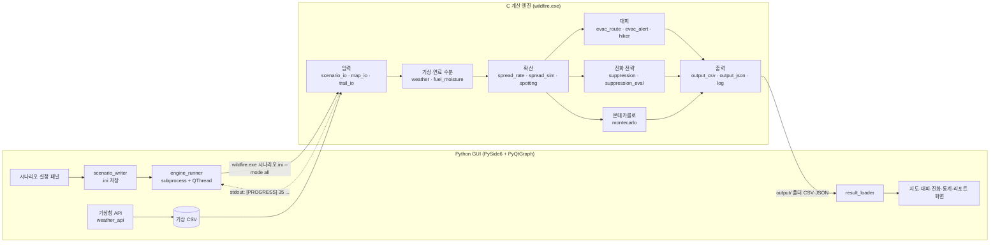
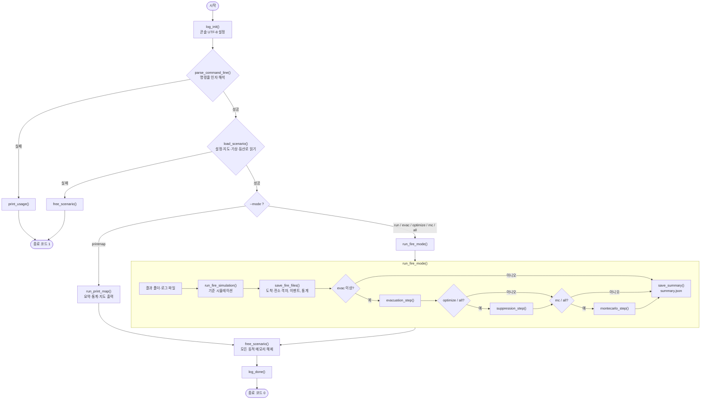

# 발표 준비 자료 (presentation_notes.md)

> 발표 영상에서 **한 사람당 4분 이상** 코드를 설명해야 한다.
> 발표 분담은 아직 정하지 않았으므로, 이 문서는 **독립된 파트(A~H)** 로 나누고 파트마다 예상 시간을 적었다.
> 두 사람이 파트를 골라 나누면 된다. (예: 각자 8분 안팎)
>
> 숫자는 모두 이 저장소의 실제 실행 결과다 (기본 시드 42). 다시 확인하려면 `python tools/run_tests.py` 와 아래 "시연 순서"를 실행한다.

---

## 목차

| 파트 | 내용 | 예상 시간 |
|---|---|---|
| A | 프로젝트 소개와 블록 다이어그램 | 1분 30초 |
| B | main 함수 순서도와 구조체 | 2분 |
| C | 입력: 시나리오·지도·등산로 읽기 | 2분 |
| D | 확산 엔진: 속도 공식과 한 단계 진행 | 2분 30초 |
| E | 대피: 위험 지도, 안전 경로, 경보 | 2분 30초 |
| F | 진화 전략: 점화 트리와 탐욕법 | 2분 |
| G | 몬테카를로와 실제 기상 데이터 | 1분 30초 |
| H | GUI 시연, 결과, 차별점, 한계 | 2분 |
| | **합계** | **약 16분** |

---

## A. 프로젝트 소개와 블록 다이어그램 (1분 30초)

**한 줄 소개**: 기상 데이터를 받아 산불이 어떻게 번질지 예측하고, 산에 있는 등산객에게 가장 안전한 대피 경로를 안내하며, 방화선·헬기를 어디에 두면 피해가 가장 줄어드는지 계산하는 프로그램.

**목적 4가지**
1. 산불 확산 예측 — 연료(숲 종류), 경사, 바람, 습도를 반영한 1분 단위 시뮬레이션
2. 등산객 대피 — 불이 오는 시각을 고려한 가장 안전한 경로 + 5단계 경보
3. 진화 전략 — 방화선 위치 최적화(탐욕법), 헬기 살수, 전략 4가지 비교
4. 몬테카를로 — 100번 반복으로 연소 확률 지도와 피해 범위

**역할 분담 (언어)**: 계산은 전부 **C** (`wildfire.exe`, 약 9,000줄), 화면·기상 API·지형 생성·테스트는 **Python** (약 4,400줄).



**말할 내용**
- Python이 C 프로그램을 실행하면서 시나리오 파일 경로를 넘긴다.
- C는 진행 상황을 `[PROGRESS] 35 확산 126/600분` 처럼 한 줄씩 출력하고, Python은 그 줄을 읽어 화면 위쪽에 표시한다.
- C가 결과를 CSV·JSON으로 저장하면 Python이 읽어서 애니메이션으로 재생한다.
- 두 언어는 파일과 표준출력으로만 연결되므로 각자 따로 테스트할 수 있다.

---

## B. main 함수 순서도와 구조체 (2분)

### main 함수 순서도 (`c_core/src/main.c`, main 함수 66줄)



**말할 내용**
- main은 "준비 → 읽기 → 모드별 계산 → 해제" 네 덩어리뿐이고, 실제 일은 함수로 나눴다.
- 실패하면 어느 단계든 `free_scenario()`를 거쳐 끝나므로 메모리가 새지 않는다(valgrind로 확인).
- 종료 코드 0/1/2/3으로 성공·입력 오류·메모리 부족·기타를 GUI에 알린다.

### 구조체 (`c_core/include/wf_types.h`)

| 구조체 | 역할 | 발표 포인트 |
|---|---|---|
| `Cell` | 격자 한 칸: 고도, 경사, 연료, 수분, 상태, **불 도착 시각**, 8방향 진행 거리, **불을 붙인 셀(parent_index)** | 배열 `progress[8]`, 열거형 `CellState` |
| `Grid` | 2차원 격자: `Cell **cells` → `cells[y][x]` | **포인터의 포인터로 만든 2차원 동적 배열** |
| `FuelModel` | 연료별 기본 속도, 소화 수분, 연소 시간, 바람·경사 계수 | 파일(`fuel_models.csv`)에서 읽음 |
| `WeatherRecord`, `WeatherSeries` | 시각별 기온·습도·풍속·풍향, 그 목록 | 동적 배열 |
| `TrailNode`, `TrailEdge`, `TrailGraph` | 등산로 그래프: 노드(대피소·주차장…), 간선(지나는 셀 목록, 길이, 오르막) | 인접 리스트 `IntArray *adjacent` |
| `Hiker`, `Route` | 등산객 일행과 대피 경로(노드 순서, 최소 안전 여유) | 구조체 안의 구조체 |
| `Scenario` | 위의 모든 것을 묶은 최상위 구조체 | 함수마다 `Scenario *sc` 하나만 넘기면 됨 |
| `SimResult`, `FireState` | 시뮬레이션 결과(통계·이벤트), 진행 중 상태(화선·연소 목록) | |
| `DangerMap`, `MonteCarloResult`, `SuppressionReport` | 위험 지도, 반복 실험 결과, 전략 비교 결과 | 4~6단계 |

```c
/* 2차원 격자. cells[y][x] 로 접근한다. (y = 0 이 지도의 북쪽 끝) */
typedef struct {
    int     width, height;
    double  cell_size_m;
    double  xll, yll;
    Cell  **cells;        /* 행 포인터 배열: cells[y]는 y번째 행(Cell 배열)을 가리킨다 */
} Grid;
```

---

## C. 입력: 시나리오·지도·등산로 읽기 (2분)

### `load_scenario` (scenario_io.c, 46줄)
- `.ini` 파일을 한 줄씩 읽어 `[구역]`과 `키 = 값`을 해석해 `Scenario`에 채운다.
- 그다음 연료 표 → 지형 → 연료 지도 → 경사 → 기상 → 등산로 → 등산객 순서로 파일을 불러온다.
- **오류를 만나도 멈추지 않고 끝까지 검사**해서 "파일 몇 번째 줄, 어떤 키, 왜 틀렸는지"를 한꺼번에 보여 준다.

시연: `bin\wildfire.exe ..\data\scenarios\tests\bad_values.ini` →
`[ERROR] ... 13번째 줄: [time] time_step_min 의 값 'abc'는 숫자가 아님`

### `grid_create` / `grid_free` (grid.c)
```c
grid->cells = (Cell **)wf_calloc((size_t)height, sizeof(Cell *), "격자 행 포인터 배열");
for (y = 0; y < height; y++) {
    grid->cells[y] = (Cell *)wf_malloc((size_t)width * sizeof(Cell), "격자 행");
    if (grid->cells[y] == NULL) {
        grid_free(grid);   /* 중간에 실패하면 지금까지 만든 행을 모두 해제 */
        return 0;
    }
}
```
- 행 포인터 배열을 먼저 만들고 각 행을 할당한다. 해제는 반대 순서로 한다.
- `calloc`으로 시작하면 모든 포인터가 NULL이므로, 중간에 실패해도 `free(NULL)`이 안전해 한 함수로 정리할 수 있다.

### `load_asc_grid` (map_io.c, 62줄)
- GIS 표준 형식(ESRI ASCII Grid)의 헤더(가로·세로 칸 수, 칸 크기)를 읽고, 그 크기만큼 `malloc`한 뒤 `fscanf`로 숫자를 하나씩 읽는다.
- 헤더와 데이터의 경계를 찾으려고 `ftell`로 줄 시작 위치를 기억했다가, 숫자 줄을 만나면 `fseek`로 되돌아간다. → **파일 입출력**
- QGIS에서 실제 지형을 이 형식으로 내보내면 그대로 쓸 수 있다.

### `compute_slope_aspect` (map_io.c, 32줄) — Horn(1981)
- 주변 3×3 고도로 동쪽·남쪽 방향 기울기를 구해 경사(도)와 내리막 방향을 계산한다.

### `load_trail_graph` + `add_line_cells` (trail_io.c)
- 파일을 세 번 읽는다(개수 세기 → 노드 → 간선). 정확한 크기로 할당하기 위해서다.
- 간선이 지나는 셀은 **Bresenham 직선 알고리즘**(정수 덧셈만 사용)으로 구한다.
- **BFS**로 "대피소·주차장으로 갈 수 없는 노드"가 있는지 검사한다.

---

## D. 확산 엔진 (2분 30초)

### `compute_spread_rate` (spread_rate.c, 28줄) — Rothermel(1972) 단순화

```
R = R0 × η_M × (1 + φw + φs)       (m/분)
```

| 기호 | 의미 | 계산 |
|---|---|---|
| R0 | 연료별 기본 속도 | 표에서 읽음 (침엽수 1.2 m/분) |
| η_M | 수분 감쇠 | `1 − 2.59r + 5.11r² − 3.52r³`, r = 수분/소화수분 |
| φw | 바람 | 그 방향의 바람 성분 `U·cosθ`가 양수면 `kw × (U·cosθ)^bw` |
| φs | 경사 | 오르막이면 `ks × tan²(경사각)` |

**계산 예**: 침엽수, 수분 5%, 순풍 8 m/s, 평지 → `1.2 × 0.66 × (1 + 5.2) ≈ 4.9 m/분`

### `simulate_fire_step` (spread_sim.c, 60줄) — 1분 동안 불 진행
1. **화선**의 각 셀이 8방향으로 `속도 × 1분`만큼 "진행 거리"를 늘린다. 이웃까지 거리(30 m, 대각선 42.4 m)를 넘으면 점화를 **예약**하고, 넘친 거리로 도착 시각을 소수점까지 계산한다.
2. 연소 중인 셀마다 **비화**(불티)를 확률로 처리한다.
3. 예약된 셀에 **한꺼번에** 불을 붙인다. 모든 셀이 같은 시점의 상태를 보고 계산하게 하기 위해서다.
4. 연소 시간이 끝난 셀은 **전소**로 바꾼다.

**설계 이야기 (질문 대비)**
- **화선과 연소를 두 목록으로 나눈 이유**: 풀은 3분이면 다 타는데, 불이 30 m를 가려면 7분 이상 걸린다. 불꽃이 꺼질 때 확산도 멈추면 풀밭 불이 다음 칸에 닿기 전에 꺼져 버린다.
- **대각선 차단 규칙**: 대각선 양옆 두 칸이 모두 물·도로·방화선이면 불이 그 틈을 빠져나가지 못한다. 한 칸 두께 방화선이 새지 않게 하기 위해서다.

### `run_fire_simulation` (spread_sim.c)
- 매 분 "기상 보간 → 연료 수분 갱신 → (헬기 살수) → `simulate_fire_step`"을 반복하고, 10분마다 통계를 기록한다.
- 불이 완전히 꺼지면 일찍 끝낸다.

### `update_fuel_moisture` (fuel_moisture.c, 8줄)
- 기온·습도로 Simard(1968)의 평형 수분을 구한다.
- 연료 수분이 그 값을 향해 `M += (EMC − M)(1 − e^(−dt/60))`로 천천히 따라가게 한다.

---

## E. 대피 (2분 30초)

### `build_danger_map` (evac_route.c, 44줄)
- 불이 지나간 셀마다 반경 R 안의 모든 셀에 "이 시각에 근처까지 불이 온다"를 기록한다(가장 이른 시각이 남음).
- 경보용(500 m)과 경로용(60 m) 두 개를 만든다.
- 모든 셀에서 주변을 검사하지 않고 **불탄 셀에서 바깥으로 퍼뜨리므로** 빠르다.

### `find_safest_route` (evac_route.c, 56줄) + `relax_neighbors` + `pick_best_exit` — 다익스트라 변형
- **안전 여유** = (그 지점에 불이 오는 시각) − (내가 지나는 시각). 경로의 안전도는 경로 위 **가장 작은** 여유로 정한다.
- 노드마다 (최소 여유, 도착 시각)을 기록하고, **직접 만든 우선순위 큐**로 여유가 큰 노드부터 확정한다.
- 여유가 30분 이상이면 모두 "충분히 안전"으로 보고 가장 빠른 길을 고른다. 여유 1분을 더 얻으려고 크게 돌아가지 않게 하기 위해서다.
- 불이 끝까지 오지 않는 대피소와 주차장만 목적지로 인정한다.

### `pq_push` / `pq_pop` (pqueue.c, 각 31줄) — 이진 힙
- 배열을 트리처럼 쓴다(부모 `(i−1)/2`, 자식 `2i+1`, `2i+2`).
- 넣을 때는 부모보다 작으면 위로 올리고, 꺼낼 때는 마지막 원소를 맨 위에 놓고 아래로 내린다.

### `assess_alert_level` (evac_alert.c, 18줄)
- 등산객 위치 주변 500 m 안에 불이 오기까지 남은 시간을 기준과 비교한다.
- 120분 미만이면 주의, 60분 미만이면 대피준비(→ 출발), 30분 미만이면 즉시대피이다. 안전한 경로가 없으면 고립(구조 요청)이다.

### `build_hiker_track` (hiker.c, 59줄)
- 경로의 셀을 하나씩 걸으며 **Tobler 보행 함수**(경사에 따라 속도 변화)로 시각을 계산한다.
- 다음 셀에 불이 먼저 와 있으면 그 자리에서 고립으로 처리한다.

**결과 (발표용)** — `spring_danger_valley.ini` (계곡 발화, 남서풍 11 m/s, 신고 140분 지연, 10시간)
- 5팀 21명 중 **고립 1팀**(계곡대피소의 가족 4명 — 신고 시각에 이미 모든 길이 막힘), 위험 2팀 7명
- 신고 지연을 60분으로 줄이면 시드 6개 모두 고립 0팀 → **"경보 기준보다 조기 발견이 핵심"**

---

## F. 진화 전략 (2분)

### `compute_subtree_values` (suppression.c, 32줄) — 점화 트리
- 셀마다 "누구에게서 불을 받았는지(parent_index)"를 이으면 발화 지점을 뿌리로 하는 **트리**가 된다.
- 불이 늦게 도착한 셀부터 차례로 자기 값을 부모에게 더하면, 각 셀의 "하위 가치"(= 이 셀을 막으면 막을 수 있는 셀 수)가 된다. 정렬은 `qsort`를 쓴다.

### `optimize_firebreak` (suppression.c, 51줄) + `try_candidates` + `accept_segment` — 탐욕법
1. 하위 가치가 큰 곳에, 불이 들어오는 방향에 **수직인 5칸 방화선 조각** 후보를 만든다.
2. 점수 상위 3개를 **실제로 시뮬레이션**해 보고 피해가 가장 작은 조각을 확정한다.
3. 60칸이 될 때까지(또는 더 이상 피해가 줄지 않을 때까지) 반복한다.
4. "방화선 + 헬기" 전략용으로는 **헬기 살수까지 함께 시뮬레이션하며** 한 번 더 고른다(`heli_guide` 인자).
   - 헬기 없이 고른 계획과 둘 다 헬기와 함께 시험해 보고, 더 좋은 쪽을 쓴다(`keep_better_heli_plan`).

### `plan_helicopter_drops` (suppression.c, 48줄)
- 출동 시각마다 화선 중 "앞으로 가장 큰 피해를 낼 곳"을 헬기 대수만큼 골라 반경 2칸에 살수한다. 젖은 곳은 45분 동안 불이 붙지 않는다.

### `rng_seed_for_event` (rng.c, 8줄) — 공정한 비교를 위한 난수
- 처음에는 "방화선 + 헬기"가 "헬기"보다 나쁘게 나왔다.
- 원인: 방화선이 셀 하나만 바꿔도 이후 모든 비화 난수가 밀렸다.
- 해결: (시드, 셀, 시각)으로 사건마다 난수를 고정했다(공통 난수 기법).

**결과 (발표용)**
| 전략 | 기본 시나리오 | 위험 시나리오 (위험 인원) |
|---|---|---|
| 대응 없음 | 584.3 ha | 2,783.7 ha (2팀 7명) |
| 방화선 60칸 | **167.8 ha (−71.3%)** | 2,570.3 ha (−7.7%, 1팀 4명) |
| 헬기 3대 | 297.6 ha (−49.1%) | 2,607.3 ha (−6.3%, 1팀 4명) |
| 방화선 + 헬기 | **4.9 ha (−99.2%)** | **2,373.5 ha (−14.7%, 1팀 4명)** |

(8단계부터 낮/밤 반영: 10시간 중 일몰 뒤에는 헬기가 뜨지 못한다 — 헬기 전략 기본 24회, 위험 18회 출동 중지)

- 기본 시나리오(10시간, 9 km 지도): 방화선만으로 피해가 70% 넘게 준다.
  - **헬기를 고려해 방화선을 고르면** 둘을 함께 쓸 때 99% 넘게 준다. 헬기가 불을 늦추는 동안 방화선이 작은 불을 둘러싸 초기에 가둔다.
  - 헬기를 모르고 고른 방화선에 헬기를 더하면 66.8%에 그친다 → "두 자원을 함께 계획해야 한다"
- 위험 시나리오: 10시간 동안 2,800 ha가 타는 큰 불이라 짧은 방화선 조각으로는 피해가 거의 줄지 않는다(탐색이 15칸에서 멈춤).
  → **큰 불에서는 진화보다 대피가 먼저**

---

## G. 몬테카를로와 실제 기상 (1분 30초)

### `run_monte_carlo` (montecarlo.c, 77줄) + `insert_smallest` (14줄)
- 같은 조건을 100번 실행하며 비화 시드와 기상 오차(풍속 ±1 m/s, 풍향 ±15°, 습도 ±5%)를 바꾼다.
- 셀이 탄 횟수 / 100 = **연소 확률**
- 셀마다 "가장 이른 도착 시각 10개"만 **삽입 정렬**로 유지한다. 그 10번째가 "가장 이른 10%" 도착 시각이다(메모리: 100 × 9만 → 10 × 9만).
- 그 시각으로 대피를 다시 계산하면 **보수적 대피 안내**가 된다.

**결과**: 기본 시나리오 100회 → 평균 526.3 ha, 표준편차 171.0, 최소 208 ~ 최대 913 ha (기준 시뮬레이션 584.3 ha)
→ 같은 조건에서도 피해가 4.4배까지 다르다. 한 번의 시뮬레이션만 믿으면 위험하다.

### 기상청 단기예보 (`gui/services/weather_api.py`)
- 위도·경도 → 기상청 5 km 격자(람베르트 정각원추 투영)
  - 서울 → (60, 127), 부산 → (98, 76)으로 확인했다.
- 가장 최근 발표 시각의 예보에서 기온(TMP)·습도(REH)·풍속(WSD)·풍향(VEC)을 시각별로 묶어 엔진 형식 CSV로 저장한다.
- API 키는 `config/api_keys.ini`에만 둔다(git 제외). 오류 메시지에서도 키를 가린다.

---

## H. GUI 시연, 차별점, 한계 (2분)

### 시연 순서 (영상 촬영용)
1. `python gui/main.py` → 기본 시나리오 지도(음영기복·연료·등고선·등산로)
2. 기본 설정 `spring_danger_valley` 선택, "진화 전략"과 "몬테카를로" 체크 → **🔥 시뮬레이션 실행**
   - 상단 진행률이 C 엔진 출력에 따라 올라가는 것 보여 주기 (약 1분 10초 — 영상에서는 편집으로 줄이기)
3. **지도 탭** 재생:
   - 불이 노랑 → 빨강 → 검정으로 번진다.
   - 등산객 ◆가 경보 색으로 이동한다.
   - 오른쪽 표에서 H4(가족) 클릭 → 경로가 빨간 굵은 선으로 표시되고 "출발 시점에 이미 모든 경로가 위험" 안내가 나온다.
4. 대피 안내 "예측 기준"을 **보수적 예측**으로 바꾸기 → 이 시나리오에서는 결과가 같다(위험 2팀 7명). 몬테카를로로 불이 가장 빨리 오는 경우를 가정해도 안내가 바뀌지 않는다는 뜻이다
5. **진화 전략 탭**: 대응 없음 vs 방화선 + 헬기 나란히 재생(흰 방화선, 하늘색 살수)
6. **통계 탭**: 피해 면적 그래프, 몬테카를로 분포, 연소 확률 지도
7. **리포트 탭**: 저장 → 브라우저로 `report.html` 열기
8. (선택) 엔진 로그 탭: C가 출력한 콘솔 지도·표

화면 캡처: `docs/images/` (gui_map_evacuation.png, gui_suppression.png, gui_stats.png, gui_engine_log.png, gui_weather_dialog.png)

### 다른 산불 시뮬레이션 프로그램과의 차별점

> 아래 다른 프로그램 설명은 공개된 소개 자료를 바탕으로 한 일반적인 특징이다. 발표 전에 각 기관의 공식 자료로 한 번 더 확인할 것.

| 구분 | 대표 예 | 주된 목적 | 우리 프로그램과 다른 점 |
|---|---|---|---|
| 확산 예측 전문 도구 | FARSITE·FlamMap (미국 산림청 계열), Prometheus (캐나다), Spark (호주 CSIRO) | 정밀한 연료·지형 자료로 화선 확산 예측 | 등산객 개인의 대피 경로·경보, 진화 전략 자동 비교는 주된 기능이 아님 |
| 국내 기관 시스템 | 국립산림과학원·산림청의 산불확산 예측 시스템 | 실제 산불 대응 지원 | 실제 운영 시스템이라 훨씬 정밀함. 우리 것은 교육용으로 알고리즘을 직접 구현·공개함 |

**우리 프로그램의 특징**
1. **실제 기상 예보 입력** — 기상청 단기예보를 받아 바로 시뮬레이션 (오프라인 샘플도 있음)
2. **등산객 중심 대피 안내** — 등산로 그래프 위에서 "불 도착 시각 − 내가 지나는 시각"(안전 여유)이 가장 큰 경로를 찾는다. 위치별 5단계 경보, 고립 판정
3. **진화 전략 비교** — 방화선 위치를 탐욕법으로 찾고, 헬기와 조합한 4가지 전략을 **피해 면적과 위험 등산객 수**로 함께 비교한다(공통 난수로 공정하게)
4. **불확실성 표현** — 몬테카를로 연소 확률 지도와 "보수적 예측" 대피
5. **투명성** — 모든 계수에 [근거]/[가정]을 표시했고(`docs/model.md`), 핵심 계산을 외부 라이브러리 없이 C로 직접 구현했다

### 한계 (솔직하게)
- 확산 모델이 단순화되어 있고 연료 계수가 가정값이다. 실제 산불 기록으로 보정하지 않았다.
- 지형·등산로가 가상이다. 실제 DEM·등산로는 같은 형식으로 넣을 수 있지만 시험하지 않았다.
- 수관화(나무 꼭대기로 번지는 불), 진화 인력의 이동, 연기는 다루지 않는다.
- 대피 경로 탐색은 시간에 따라 바뀌는 그래프라 항상 최적을 보장하지 않는다.
- **교육용 시뮬레이션이며 실제 재난 판단에 그대로 쓰면 안 된다.**

---

## 과제 조건 체크리스트 (C 문법 요소가 쓰인 곳)

| 요소 | 쓰인 곳 (예) |
|---|---|
| 구조체 | `wf_types.h`의 `Cell`, `Grid`, `Scenario` 등 20여 개. 구조체 안의 구조체(`Hiker` 안의 `Route`), 구조체 배열(`FuelModel fuels[32]`) |
| 포인터 | 모든 함수가 `Scenario *sc`를 받음. 출력 인자(`double *dead_moisture`), 포인터의 포인터(`Cell **cells`), 문자열 처리(`str_trim`) |
| 동적 할당 | 할당(`malloc`·`calloc`·`realloc`) 50곳, `free` 59곳. 2차원 격자, 동적 배열(`dynarray.c`, 2배씩 늘리기), 경로 셀 목록(정확한 크기 계산 후 할당) |
| 파일 입출력 | 읽기: `fopen`/`fgets`/`fscanf`/`ftell`/`fseek` (시나리오·지형·연료·연료표·기상·등산로·등산객), 쓰기: `fprintf` (CSV·JSON·로그), 디스크 오류 검사(`ferror`) |
| 2차원 배열 | 격자 `cells[y][x]`, 콘솔 지도 캔버스 `char **canvas` |
| 알고리즘 | 다익스트라(+이진 힙), BFS, Bresenham 직선, 삽입 정렬, `qsort`, 탐욕법, 트리 누적 합, 선형 보간 |
| 메모리 누수 없음 | valgrind로 모든 모드와 오류 경로를 확인 ("All heap blocks were freed") |
| 경고 없음 | gcc `-Wall -Wextra -Wpedantic -Wconversion`, clang `-Weverything`에서 경고 0개 (MSVC `/W4`는 Windows에서 확인) |
| 읽기 쉬운 코드 | C 함수 302개, 평균 20줄, 80%가 30줄 이하. 한국어 주석 |

---

## 예상 질문과 답변

**Q1. 왜 셀 격자(셀룰러 오토마타) 방식으로 했나? FARSITE는 다른 방법(Huygens 화선 전파)을 쓴다던데.**
격자 방식은 셀마다 상태와 도착 시각이 있어 C 배열로 구현하고 설명하기 쉽다. 바람이 바뀌거나 비화·헬기 살수가 끼어드는 것도 셀 단위로 자연스럽게 처리된다. 대신 8방향으로만 번져 화선 모양이 각진다는 한계가 있다.

**Q2. 대피 경로가 최적이라고 할 수 있나?**
항상 최적은 아니다. 불이 시간에 따라 움직여 도착 시각이 경로마다 다르기 때문이다(시간 의존 그래프). 다익스트라의 "한 번 확정하면 바뀌지 않는다"는 성질이 완전히 성립하지 않는다. 노드 11개인 가상 등산로에서는 결과를 눈으로 검증했고, 이 한계를 문서에 적었다.

**Q3. 탐욕법으로 고른 방화선이 최선인가?**
최선이라는 보장은 없다. 다만 셀 9만 개 중 60칸을 고르는 모든 조합을 시험하는 것은 불가능하다. 그래서 점화 트리 점수로 후보를 추리고 상위 3개만 실제로 시뮬레이션하는 방식으로 몇 초 안에 계산한다.

**Q4. 결과가 맞는지 어떻게 확인했나?**
실제 산불 자료로 보정하지는 않았다. 대신 다음과 같이 확인했다.
- 물리적으로 타당한지: 바람 부는 쪽으로 길게, 오르막으로 빠르게, 젖으면 꺼짐
- 같은 시드로 다시 실행하면 같은 결과인지
- 26개 자동 테스트(`tools/run_tests.py`)와 경계 조건(불이 안 붙음, 등산객 없음, LF·CRLF 줄바꿈 등)

**Q5. 개발하면서 가장 어려웠던 버그는?**
1. Bresenham 직선에서 `2*error`를 한 번만 계산해야 하는데 두 번 계산해 배열 범위를 넘었다(AddressSanitizer로 발견).
2. 전략 비교에서 비화 난수가 밀려 결과가 뒤집혔다(공통 난수로 해결).
3. 연료가 소화 수분에 도달하면 확산 속도가 0이어야 하는데, 실수 계산 오차로 `4.44 × 10⁻¹⁶`이 나와 불이 영원히 안 꺼진 것으로 판단됐다.
4. 리눅스에서는 잘 되던 지도 읽기가 Windows에서만 "값이 부족함" 오류를 냈다. 줄바꿈이 LF인 파일을 텍스트 모드로 열면 Windows의 `ftell`이 줄마다 1바이트씩 틀린 위치를 알려 주어, 첫 숫자를 건너뛴 것이었다. 바이너리 모드(`"rb"`)로 열어 해결했고, LF·CRLF 입력을 모두 시험하는 테스트를 추가했다.

**Q6. 왜 C와 Python을 섞었나?**
과제 조건이 "핵심 계산은 C"이다. 계산은 C로 빠르게 했다(10시간 시뮬레이션 1회 약 0.4초, 몬테카를로 100회 약 30~45초). 화면과 인터넷(기상 API)은 Python 라이브러리가 편해서 Python으로 했다. 둘은 파일과 표준출력으로만 연결된다.

**Q7. 기상청 API 키는 어디에 있나?**
`config/api_keys.ini`(GitHub에 올리지 않음)에만 둔다. 코드에는 없고, 오류 메시지에서도 키를 가린다.

**Q8. 계절은 어떻게 반영했나? (9단계)**
기상청 서울 평년값(1991~2020)으로 계절마다 평균 기온·일교차·습도·바람을 정하고, C 엔진이 하루 동안의 변화를 직접 만든다.
오후 3시에 가장 덥고, 이슬점을 일정하게 두어(Magnus 식) 기온이 오르면 습도가 내려간다 → 오후에 불이 잘 번진다.
같은 불을 계절만 바꿔 돌리면 봄 568 ha > 겨울 294 ha > 가을 195 ha > 여름 86 ha로, 봄 산불이 가장 위험하다는 통계 경향과 같다.
겨울엔 해발 600 m 위가 눈에 덮여 불이 능선을 넘지 못하고(눈 셀 6,248칸), 등산객은 눈길에서 25% 느리게 걷는다.
지도도 봄 진달래·여름 짙은 초록·가을 단풍·겨울 눈으로 바뀌어 계절을 한눈에 알 수 있다.
